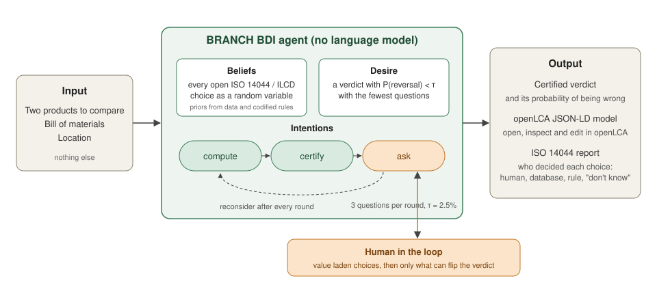

<div align="center">
<h1>BRANCH: Belief Revising Agent for Non-expert Certified Human-in-the-loop LCA</h1>

<a href="docs/BRANCH_Project_Proposal_v2.pdf"></a>
<a href="paper/main.pdf"></a>
<a href="https://github.com/ashirabench/branch/releases/latest"></a>
<a href="LICENSE"></a>


<a href="https://github.com/ashirabench/branch/actions/workflows/tests.yml"></a>

**Department of Informatics Engineering, University of Coimbra**
Human-Centered Artificial Intelligence, 2026/2027

[Ashira Benchimol](https://github.com/ashirabench)

</div>

<p align="center"></p>

```bibtex
@misc{benchimol2026branch,
  title  = {Asking Only What Can Flip the Verdict: A Human-in-the-Loop {BDI} Agent
            for Comparative Life Cycle Assessment},
  author = {Benchimol, Ashira},
  year   = {2026},
  note   = {Lab project paper, Human-Centered Artificial Intelligence,
            Department of Informatics Engineering, University of Coimbra},
  url    = {https://github.com/ashirabench/branch}
}
```

## Updates

- [Nov 15, 2026] Release v0.1.2: PET and polyethylene now use the disposal datasets of their own polymer in BAFU:2026 (they had been using a plastics mixture), and expanded polystyrene uses its own incineration dataset. The whole benchmark and every validation against openLCA ran again; no verdict changed at the central values, and the mean number of questions in the chosen setting went from 2.75 to 2.87. The paper now names the stand-ins that remain (landfill of PET, the obsolete packaging glass datasets, the oil-fired plant in Brazil) and reports a larger run of 5,400 sessions for the certificate. A factor file extracted before this release needs the six new disposal factors: with openLCA open, `python experiments/extract_factors.py --method "EF 3.1" --update` reads only what is missing.
- [Nov 14, 2026] Release v0.1.1: installers for macOS (Apple silicon and Intel) and Windows with everything in this list: any product described by processes of the openLCA database, 15 materials, the search of the database and the automatic reading of missing factors. The page shows the version, and GitHub Actions now runs one whole comparison in each built app (version, questions, manager report) before it publishes the installer.
- [Nov 14, 2026] Any product, not only containers. A product can now be described by processes chosen from the openLCA database by name, one per life cycle stage, with an amount or the smallest and the largest amount when it is not known; BRANCH asks for the exact amount only if it can change the answer. The app searches the database, shows the unit of each process and reads its factor from openLCA on its own. Two example products that are not containers agree with openLCA to 4.7e-10 ([`paper/data/validation_any_product.csv`](paper/data/validation_any_product.csv)). The reports now name the split toxicity indicators (organics, inorganics) instead of repeating one name. One command uses the whole app against a real openLCA, from the search to "Send to openLCA": `python experiments/check_app_with_openlca.py` (all steps passed on 14 November 2026).
- [Nov 14, 2026] Eight more packaging materials as data files: polypropylene, polystyrene, expanded polystyrene, PVC, PLA, steel sheet (tinplate proxy), kraft paper and cartonboard, each with an example product in [`data/examples/`](data/examples). With corrugated board, the nine added materials were checked against openLCA for every dataset option in PT, DE and BR (42 products, largest relative difference 6.7e-9, [`paper/data/validation_new_materials.csv`](paper/data/validation_new_materials.csv)). Their recycling rates are assumptions, except for polypropylene (the national rate of all plastics) and, in Germany, for paper, board and steel. The app offers a material only when its factors are in the factor file; one command extracts and checks them: `bash experiments/new_materials_session.sh`.
- [Nov 13, 2026] Experiments promised in the proposal, on a plan fixed before running ([`experiments/PLAN_2026-11-13.md`](experiments/PLAN_2026-11-13.md)): the chosen setting in three other impact categories (acidification, water use, fossil resource use) and two knowledge ablations (no location, uniform priors). Descriptive results in the paper, summaries in `paper/data/proposal_2026-11-13/`, one command to repeat them: `bash experiments/run_proposal_experiments.sh`.
- [Nov 13, 2026] Corrugated board added as a material (`data/materials/corrugated_board.json`, example product in `data/examples/`); its German recycling rate is sourced, the default is an assumption, and its check against openLCA in a product system ran on 14 November (entry above). The connection panel of the app now lists the four steps before the first comparison and names the next one.
- [Nov 13, 2026] Paper: the discussion now states what BRANCH offers a small company (about three answers instead of 16 open choices and 10 to 21 linked exchanges per comparison, with every default visible) and what it cannot claim yet (no person outside the project has used it), and it lists the departures from the proposal. It also states that only Portugal, Germany and Brazil have national priors, and that the other electricity grids of the database run on default priors. `CONTRIBUTING.md` and `docs/lemma.md` point to the current files.
- [Nov 13, 2026] Priors checked against published values (`data/prior_checks.csv`, with a test). Two priors widened to include a published value: heat for washing, and the mass of the refillable glass bottle in Brazil. The aluminium foil of the carton has its own prior of recycled content.
- [Nov 13, 2026] Title and acronym now say human in the loop, the base of the method. Validation against openLCA repeated with the national priors.
- [Nov 13, 2026] Benchmark re-run with the national priors; paper, tables and figures rebuilt from it. The paper states where the human is in the loop (the base of the method) and where the human is in command.
- [Nov 4, 2026] Priors of recycling, disposal and recycled content from national statistics for Portugal, Germany and Brazil. "Finish now" button in the app.
- [Nov 2, 2026] First version of the **BRANCH for openLCA** installers for macOS (Apple silicon and Intel) and Windows, built and smoke tested by GitHub Actions.
- [Nov 2, 2026] Validation against openLCA on 166 products in every electricity grid of BAFU:2026 and two Brazilian regions (largest relative difference 1.1e-8); unit audit of all factors.
- [Nov 2, 2026] Statistics at the case level (paired permutation test with Holm correction, bootstrap over cases) and a run with new seeds for the chosen setting.
- [Nov 1, 2026] Paper draft (IJCAI format), master script `reproduce.sh` and walkthrough notebook.
- [Oct 29, 2026] Web app for companies, manager report (PDF), regions down to Amazonas (Manaus), materials as data files, hosting with Docker.
- [Oct 29, 2026] openLCA connector: the resolved comparison goes back to openLCA with every exchange linked to its BAFU process. The report now shows how much end of life weighs and the smallest change that reverses the verdict.
- [Oct 29, 2026] Generic builder: any two products described by a bill of materials, with the codified rules in `catalogue.py`. It reproduces the hand written PET vs glass model exactly.
- [Oct 26, 2026] Proposal v2. The query loss is now p(1 − p) instead of min(p, 1 − p), which made the agent stall. BAFU:2026 replaces the Environmental Footprint database, whose licence agreements expired in December 2025.
- [Oct 26, 2026] First real case: single use PET vs refillable glass, Portugal, with BAFU:2026 factors (EF 3.1).
- [Oct 26, 2026] Engine released: beliefs, Monte Carlo, query strategies, BDI agent, report.
- [Oct 16, 2026] Repository created.

## Overview

openLCA is the reference open source tool for Life Cycle Assessment. It calculates what the user models; the modelling choices that ISO 14044 and the ILCD Handbook leave to expert judgement are the user's, and that is where a non expert gets stuck. BRANCH is a companion agent for openLCA that **contains no language model**. From a bill of materials and a location, a BDI agent (Beliefs, Desires, Intentions):

1. completes every remaining modelling choice from data and codified rules, keeping each one as an **explicit random variable** rather than a hidden default;
2. computes the result by Monte Carlo on unit impact factors extracted once from openLCA, so each step takes milliseconds;
3. asks the human **only the questions whose answer can reverse the verdict**, in order of decision value, accepting "I don't know" and "finish now", and stops when the verdict is robust;
4. returns an importable openLCA model and a report structured by ISO 14044.

Value laden choices (for instance, including capital goods) are flagged and always asked: they stay with the human.

**Who it is for.** Small and medium enterprises that must now provide LCA grade data on their products and packaging (PPWR, CSRD, Environmental Footprint, Digital Product Passport) but have no LCA expert. BRANCH is free and open source, uses only free data (BAFU:2026 and the openLCA LCIA methods pack), and keeps the full life cycle as ISO 14044 requires while showing **how much disposal weighs** in the result and **which change in disposal, recycling or reuse would reverse the verdict**.

## Web App for Companies

No Python and no openLCA needed on the company's side: a browser page where you pick the region, type two bills of materials (part, material, grams), answer the few questions BRANCH asks, and download a one page manager report (PDF, plain English) plus the technical report.

```bash
pip install -e ".[app]"
BRANCH_DEMO=1 python app.py                                          # interface with illustrative numbers
python app.py                                                       # real factors: newest file in data/factors/
```

Open http://127.0.0.1:7860. To host it for companies (Docker, factors mounted on the server and never served), see [`docs/DEPLOY.md`](docs/DEPLOY.md).

## Quick Start

```bash
git clone https://github.com/ashirabench/branch.git
cd branch
python -m venv .venv && source .venv/bin/activate
pip install -e ".[all]"
pytest
```

Run the agent on the toy case with a simulated human:

```python
from branch import run_agent
from branch.cases import toy_packaging, draw_truth

model = toy_packaging()                      # PET vs refillable glass, PLACEHOLDER numbers
truth = draw_truth(model, seed=0)            # a simulated expert answers from this world

result = run_agent(model, oracle=lambda name: truth[name], strategy="decision_flip", truth=truth)
print(result["verdict"], result["p_flip"], result["certified"], result["questions"])
# Glass < PET 0.00135 True 3
```

`oracle(name)` returns the human's answer, or `None` for "I don't know". The result also holds `decided_by` (human, prior or unknown for every choice), the impact intervals of both alternatives, and the full trace.

## Detailed Usage

<details>
<summary>Talk to the agent in the terminal</summary>

```bash
python experiments/demo_cli.py --toy                  # placeholder toy case, no openLCA needed
python experiments/demo_cli.py --region PT           # real BAFU:2026 factors (any code in data/regions)
```

The agent asks whether the comparison will be disclosed to the public (if so, it states that ISO 14044 requires a critical review panel, which BRANCH prepares for but does not replace) and writes `outputs/report.md`.
</details>

<details>
<summary>Compare any two products</summary>

A product is a bill of materials in a JSON file. Anything you state is fixed; anything you leave out is completed from the codified rules in [`branch/catalogue.py`](branch/catalogue.py) and becomes an explicit choice the agent may ask about.

```json
{
  "id": "can",
  "name": "Aluminium can 330 ml",
  "volume_l": 0.33,
  "refillable": false,
  "components": [{"id": "body_and_lid", "material": "aluminium", "mass_g": 13}],
  "materials": {"aluminium": {"recycled_content": 0.5}}
}
```

```python
from branch.real_cases import compare

model = compare("aluminium_can_330ml", "beverage_carton_1l", region="DE")   # benchmark names
model = compare("my_product.json", "pet_bottle_1l", region="PT")           # or your own file
```

```bash
python experiments/demo_cli.py --a aluminium_can_330ml --b beverage_carton_1l --region DE
```

Materials in the catalogue: PET, HDPE, LDPE, glass, aluminium and liquid packaging board (the six of the benchmark), and nine added as data files that no benchmark case uses: corrugated board, cartonboard, kraft paper, polypropylene, polystyrene, expanded polystyrene, PVC, PLA and steel sheet (a proxy for tinplate, without the tin coating). These materials come with codified rules for containers (forming, distribution, refill, end of life). Any other product is described by processes chosen from the database: see [Any product](#any-product). The benchmark products are in [`data/benchmark/`](data/benchmark). Before comparing new products, extract only the factors they need:

```bash
python experiments/extract_factors.py --update --specs aluminium_can_330ml beverage_carton_1l --region DE
```
</details>

<details>
<summary>Regions, from Portugal to the Amazon</summary>

A region is a JSON file in [`data/regions/`](data/regions) that states only what differs from its parent: electricity mix (or a question, such as national grid versus isolated system), delivery and supply legs by transport mode (lorry, barge, rail), and regional priors such as recycling rates.

```
GLO ── PT, DE
    ├─ EU ── 25 other countries of the European Union, Iceland and Norway
    └─ BR ── BR-N (Northern Brazil) ── BR-AM (Amazonas, Manaus: river supply, isolated grids)
```

```python
compare("aluminium_can_330ml", "beverage_carton_1l", region="BR-AM")
```

For Portugal, Germany and Brazil the recycling rates, the split between incineration and landfill, the recycled content and (for Germany) the trips of refillable bottles come from national statistics: Eurostat and the APA packaging reports for Portugal, BMUV, GVM and ZSVR for Germany, ABIPET, ABRALATAS, Tetra Pak and ABREMA for Brazil. Each value names its document and year in the `SOURCE:` tag. Component masses, trips (outside Germany), washing, distribution distance, the recycled content of aluminium, the recycled content of PET in Brazil and the burden of recycled PET are still `ASSUMPTION:` priors, and the subregions BR-N and BR-AM still rest on assumptions.

For the 25 other countries of the European Union, Iceland and Norway, the recycling rates of plastic, aluminium, steel, paper and glass packaging and the split between incineration and landfill come from two Eurostat tables (`env_waspacr` and `env_wasmun`, years 2022 to 2024) kept in [`data/eurostat/`](data/eurostat). `python experiments/make_eu_regions.py` writes those 28 files from the tables and states its rules; nobody edits them by hand. Eurostat gives one rate for all plastic packaging and none for beverage cartons, and each file says so.

To add a place, copy the closest file, set `parent`, and change only what is different. Every prior keeps its `SOURCE:` or `ASSUMPTION:` tag, and `sources_needed` lists the data still to collect; both appear in the reports.
</details>

## Any product

The agent, its questions and its certificate do not depend on packaging. Packaging is the first domain with codified rules and sourced national values; any other product is described by processes of the database (11,951 in BAFU:2026), chosen by their exact name:

```json
{
  "name": "Cotton bag",
  "functional_unit": "carrying the shopping of one household for one year",
  "units_per_functional_unit": 1,
  "exchanges": [
    {"id": "fabric", "stage": "material", "process": "Textile, woven cotton, at plant", "amount": [0.10, 0.20]},
    {"id": "sea freight", "stage": "transport", "process": "Transport, transoceanic freight ship", "amount": [0.5, 3.0]},
    {"id": "disposal", "stage": "end_of_life", "process": "Disposal, textiles, soiled, 25% water, to municipal incineration", "amount": 0.15}
  ]
}
```

- `amount` is for one product, in the unit of the process (the app's search shows it: kg, kWh, t*km, items, hours). A number is a known amount. A pair is the smallest and the largest it could be: BRANCH keeps it as an open choice, labelled as an assumption given by the user, and asks for the exact value only if it can change which product is better.
- `stage` is one of `material`, `manufacturing`, `transport`, `use`, `end_of_life`, `other`.
- When several locations share a process name, add the location code: `"location": "CH"` in a file, or `Tap water, at user @CH` in the app.
- `functional_unit` says what both products do, and `units_per_functional_unit` how many of each are needed for it.
- In the app: open **Other inputs from the openLCA database** under each product, use **Search the openLCA database** to copy the process names, and press **Compare**. With openLCA connected, the app reads the factors of the processes you chose.

What this way does not give: sourced starting values (the ranges are yours) and links between amounts (a mass and its disposal are two separate inputs). Examples: [`data/examples/cotton_bag.json`](data/examples/cotton_bag.json) and [`pp_bag.json`](data/examples/pp_bag.json).

<details>
<summary>More materials, and how to see everything openLCA can assess</summary>

openLCA has no fixed list of materials: it can assess anything whose processes are in the database you load. To see what BAFU:2026 (or any database) offers:

```bash
python experiments/list_datasets.py                       # every process, grouped, to outputs/datasets_*.csv
python experiments/list_datasets.py --grep tinplate --full  # with reference flow, unit and waste flag
```

Then add a material as a data file, without code: [`data/materials/README.md`](data/materials/README.md).
</details>

<details>
<summary>Manager report (PDF)</summary>

```python
from branch.manager_report import manager_pdf
manager_pdf(result, model, "outputs/report.pdf", public=False)
```

The answer in one sentence and how sure BRANCH is, where the impact comes from (disposal on its own), the smallest change that would flip the answer, what the person said and what BRANCH assumed, and the ISO 14044 notice on public comparisons, always printed.
</details>

<details>
<summary>Send the result to openLCA (connector)</summary>

With openLCA open on the database the factors came from and the IPC server running, BRANCH writes the resolved comparison back into it: one process per alternative, every exchange linked to the BAFU process it came from, one parameter per modelling choice with its value, question, source and who decided it, and a product system ready to calculate. It then calculates both systems in openLCA and compares them with its own numbers.

```bash
python experiments/demo_cli.py --a aluminium_can_330ml --b beverage_carton_1l --region DE --push --jsonld outputs/branch.zip
```

```python
from branch import olca_bridge
out = olca_bridge.push_comparison(olca_bridge.client(8080), model, result, verify=True)
out["check"]   # openLCA vs BRANCH, per alternative
```

The amounts are those of one world: the human's answers and the most probable value of every remaining choice. The distributions, the verdict and its probability of being wrong stay in the BRANCH report.
</details>

<details>
<summary>Use real impact factors from openLCA</summary>

The real case needs unit impact factors extracted once from openLCA 2.x with the IPC server running on port 8080. See [`data/README.md`](data/README.md).

```bash
python experiments/extract_factors.py --method "EF 3.1"
```

```python
from branch.real_cases import pet_vs_refillable_glass, assumptions

model = pet_vs_refillable_glass(region="PT", category="Climate change")
print(assumptions(model))   # priors that are still placeholders
```
</details>

<details>
<summary>Choose a query strategy</summary>

| Strategy | What it ranks |
|---|---|
| `decision_flip` | expected reduction of p(1 − p), p = P(I_A < I_B); the first order Sobol index of the verdict (proposed) |
| `decision_flip_min` | ablation with the literal loss min(p, 1 − p); scores near zero when no single answer can flip the verdict, so it asks more questions |
| `decision_entropy` | ablation with the binary entropy of p |
| `decision_flip_tp`, `decision_flip_min_tp` | ablations that estimate the two losses by total probability instead of the plug-in estimate |
| `sobol` | first order variance index of the result, not of the decision |
| `least_confident`, `margin`, `entropy` | uncertainty sampling on each choice's prior (Settles 2009) |
| `random` | random order |

```python
run_agent(model, oracle, strategy="margin", batch_size=3, n_samples=20_000, tau=0.05)
```
</details>

<details>
<summary>Run on the GPU</summary>

The same code runs on NumPy or CuPy. Install `pip install cupy-cuda12x` and set `BRANCH_BACKEND=cupy`.

```bash
BRANCH_BACKEND=cupy python experiments/bench_latency.py
```
</details>

## Experiments

The grid mirrors Faria et al. (2022): every configuration of strategy, batch size and sample size runs over many seeds, and each seed draws a different simulated expert world.

```bash
python experiments/run_grid.py --case lca --J 40 --case_seeds 4 --batch 1 3 --seeds 30 --n 10000 --tag lca_J40
python experiments/analyze.py results/lca_J40      # boxplots, P(flip) curves, Wilcoxon table
python experiments/bench_latency.py                # time to choose one question
```

`--case` is `toy` (placeholder packaging case), `lca` (synthetic linear LCA with J choices), `sym` (synthetic symmetric case) or `real` (any two product files with extracted factors):

```bash
python experiments/run_grid.py --case real --a pet_bottle_1l --b glass_refillable_1l --region PT --seeds 30
```

### Results

Every pair of four real products (PET bottle, refillable glass, aluminium can, beverage carton) in Portugal, Germany and Brazil: 18 cases × 30 seeds, climate change, BAFU:2026 factors, τ = 2.5% and three questions per round (the setting of the app). Mean questions to a certified verdict:

| Strategy | Experts from the priors | Experts from the 10% tails |
|---|:---:|:---:|
| **Decision flip, p(1 − p)** | **2.87** | **2.61** |
| Sobol index of the impact | 2.88 | 2.56 |
| Entropy, least confident | 4.64 | 3.93 |
| Random | 6.04 | 5.44 |

With experts from the priors, three questions per round and a 2.5% certificate, decision flip needs 2.87 questions on average against 4.64 for uncertainty sampling (paired permutation test over cases, Holm adjusted p = 0.004) and ties with Sobol (2.88). With experts drawn from the tails of its beliefs, the share of certified verdicts that are wrong is 1.7% on the seeds used to choose the setting (0.7 to 2.8), 2.6% on 540 sessions with new seeds (1.1 to 4.4) and 1.4% on 5,400 further sessions fixed in [`experiments/PLAN_2026-11-15.md`](experiments/PLAN_2026-11-15.md) (0.9 to 2.0). The target is 2.5%: the first new seeds sit one wrong certificate above it, and the larger run sits below it. In the same setting and on the same 18 cases, the order of the strategies is the same for acidification, water use and fossil resource use; with tail experts the share of wrong certificates is 2.6% (0.2 to 5.4), 0.9% and 1.1%. For acidification the larger run gives 3.1% (1.0 to 5.6), an interval that still contains the target; most of those wrong certificates come from PET against the aluminium can, which the agent certifies without asking. Without the location (global electricity mix, default priors) decision flip asks no more questions (2.59) but 2.0% of its certificates are wrong with prior experts and 3.7% with tail experts; with uniform priors it asks about one question more (3.74) and is not wrong more often. These runs are descriptive and reuse the same cases. Details and every other setting are in [`paper/main.pdf`](paper/main.pdf). The benchmark was re-run on 15 November 2026, after PET and polyethylene received the disposal datasets of their own polymer (they had been using a plastics mixture). No verdict changed at the central values. The summaries from before that correction are in `paper/data/before_disposal_datasets_2026-11-14/`, and those from before two priors were widened in `paper/data/before_widening_2026-11-13/`.

## Reproducing the Paper

```bash
bash reproduce.sh            # install, extract factors from openLCA, tests, full benchmark, figures, paper/main.pdf
bash reproduce.sh paper      # figures, tables and the PDF from the committed summaries in paper/data/ (no openLCA)
QUICK=1 bash reproduce.sh    # 3 seeds and batch 1, to check the pipeline in minutes
bash reproduce.sh notebook   # executes notebooks/branch_walkthrough.ipynb
```

The paper sources are in [`paper/`](paper/) (IJCAI format, `main.tex`); every number quoted in the text is generated into `paper/tables/numbers.tex` by `experiments/paper_assets.py`, so prose and tables cannot disagree. [`notebooks/branch_walkthrough.ipynb`](notebooks/branch_walkthrough.ipynb) reproduces the lemma, one session of the agent, a small benchmark and the figures in a few minutes.

## Repository Layout

```
branch/
├── branch/                  the agent (importable package)
│   ├── builder.py           bill of materials + location -> model, for any two products
│   ├── catalogue.py         codified rules: datasets, recycled content, end of life, priors per material
│   ├── beliefs.py           modelling choices as random variables; value laden choices stay with the human
│   ├── lca_model.py         linear surrogate: Term (one exchange) and Model
│   ├── montecarlo.py        shared samples, incremental updates, conditional deltas
│   ├── query.py             decision flip strategy and baselines
│   ├── agent.py             BDI control loop: compute, ask, certify; "I don't know"; ISO 14044 notice
│   ├── report.py            verdict, probability it is wrong, who decided each choice
│   ├── webapp.py            web app logic and Gradio page (app.py runs it)
│   ├── manager_report.py    plain English PDF for managers
│   ├── regions.py           regions with parents: electricity, transport legs, regional priors
│   ├── demo_factors.py      ILLUSTRATIVE factors for demos only, never for results
│   ├── whatif.py            smallest change that reverses the verdict; impact by life cycle stage
│   ├── olca_bridge.py       openLCA connector: push the comparison, verify it in openLCA, JSON-LD
│   ├── olca_extract.py      extraction of the unit impact factors from openLCA
│   ├── connector.py         BRANCH for openLCA: checks openLCA, reads the factors once, sends the comparison back
│   ├── desktop.py           desktop launcher of the installed app
│   ├── indicators.py        the 16 EF 3.1 impact categories and their units
│   ├── help.py              plain language help texts of the app
│   ├── backend.py           NumPy (CPU) or CuPy (GPU)
│   ├── cases.py             toy case (PLACEHOLDER numbers) and synthetic models
│   └── real_cases.py        load extracted BAFU:2026 factors; compare(a, b, region)
├── experiments/             grid, analysis, latency benchmark, factor extraction, terminal demo
├── tests/                   pytest suite
├── paper/                   IJCAI paper: main.tex, tables and figures generated by experiments/paper_assets.py
├── notebooks/               walkthrough notebook
├── packaging/               PyInstaller spec and Windows installer script (see .github/workflows/installers.yml)
├── reproduce.sh             master script: install, data, tests, experiments, figures, paper, notebook
├── app.py                   web app entry point (see docs/DEPLOY.md)
├── data/regions/            GLO, PT, DE, BR, BR-N, BR-AM, EU and 27 European countries
├── data/eurostat/           the two Eurostat tables behind the European region files
├── data/materials/          extra materials as JSON, no code needed
├── data/examples/           example products for added materials (not part of the benchmark)
├── data/benchmark/          product files: PET, refillable glass, aluminium can, beverage carton
├── data/factors/            extracted LCA factors, never committed (see data/README.md)
└── docs/                    proposal, lemma and deployment guide
```

## Limitations

BRANCH initially covers attributional studies in ILCD Situation A; its priors are only as good as the regional statistics behind them; and it does not replace the critical review that ISO 14044 requires for comparative assertions disclosed to the public.

## Acknowledgements

BRANCH builds on [openLCA](https://www.openlca.org), [olca-ipc](https://github.com/GreenDelta/olca-ipc.py) and [olca-schema](https://github.com/GreenDelta/olca-schema) by GreenDelta, and on the Life Cycle Inventory database of the Swiss Federal Administration (BAFU:2026). I thank the Human-Centered AI course at the University of Coimbra.

## References

BAFU (Federal Office for the Environment). 2026. *Life Cycle Inventory Database of the Swiss Federal Administration, BAFU:2026*, version 1.1. Bern: Federal Office for the Environment.

European Commission, Joint Research Centre. 2010. *International Reference Life Cycle Data System (ILCD) Handbook: General Guide for Life Cycle Assessment, Detailed Guidance*. EUR 24708 EN. Luxembourg: Publications Office of the European Union.

Faria, Bruno, Dylan Perdigão, Joana Brás, and Luis Macedo. 2022. "The Joint Role of Batch Size and Query Strategy in Active Learning-based Prediction: A Case Study in the Heart Attack Domain." In *Progress in Artificial Intelligence: EPIA 2022*. Cham: Springer.

ISO. 2006. *ISO 14040:2006 Environmental Management: Life Cycle Assessment: Principles and Framework*. Geneva: International Organization for Standardization.

Settles, Burr. 2009. *Active Learning Literature Survey*. Computer Sciences Technical Report 1648. Madison: University of Wisconsin–Madison.

Wooldridge, Michael. 2009. *An Introduction to MultiAgent Systems*. 2nd ed. Chichester: Wiley.

The full reference list is in the [proposal](docs/BRANCH_Project_Proposal_v2.pdf).

## License

Code released under the [Mozilla Public License 2.0](LICENSE), the licence of openLCA. LCA data are not included and remain under their own terms of use.

## Use of AI tools

AI (Claude, by Anthropic) was used as a support tool at every stage of this project: research, writing, code, tests, experiments, documentation and repository maintenance, including commits and pull requests. I defined the problem, took every design decision, ran the factor extraction and every validation in openLCA, reviewed every change before it entered the repository and checked every reference against its source. The Human-Centered AI course allows the use of AI tools, and the professor was informed.
